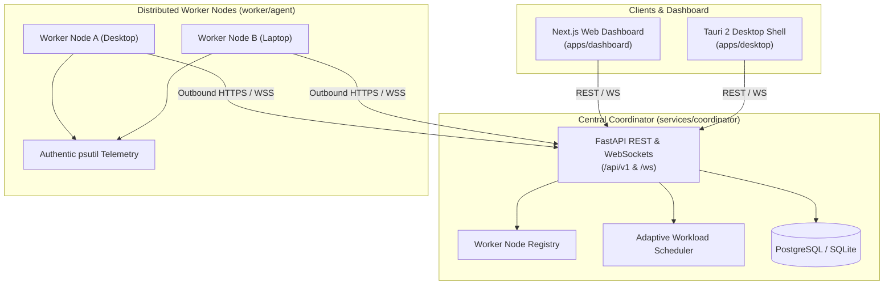

# WebSync AI

**WebSync AI** is a cross-platform distributed computing platform that connects multiple computers over a network and allows them to contribute available CPU, RAM, and supported GPU resources to execute workloads remotely.

---

## Architecture Overview



### Architectural Principles

1. **Authentic Workload Execution**: No simulations or fake telemetry. Worker resource metrics are sampled via `psutil`, and workloads execute within isolated OS-level subprocesses.
2. **Zero Inbound Port Forwarding**: Worker nodes initiate outbound TLS/HTTP/WebSocket connections to the coordinator, allowing computers behind standard home NAT and firewalls to participate without special network configuration.
3. **Discrete Node Isolation**: Memory and GPU resources are **not** pooled into a virtual unified memory pool. Workloads are scheduled to discrete machines matching required hardware quotas.
4. **Clean Monorepo Boundaries**: The backend coordinator, worker agent, desktop application, and web dashboard are strictly decoupled and share typed contracts via `@websync/shared-types` and `@websync/api-client`.

---

## Monorepo Structure

```text
WebSync_AI/
├── apps/
│   ├── dashboard/          # Next.js 15 web dashboard with Tailwind CSS & live health monitor
│   └── desktop/            # Tauri 2 native desktop application scaffold (Vite + React)
├── services/
│   └── coordinator/        # FastAPI central orchestration service & health endpoint
├── worker/
│   ├── agent/              # Python worker node agent (psutil telemetry & executor)
│   └── jobs/               # Workload definitions and execution samples
├── packages/
│   ├── shared-types/       # Canonical TypeScript interfaces (Health, Worker, Job, Metrics)
│   ├── api-client/         # Shared typed API client for coordinator communication
│   └── ui/                 # Reusable design tokens, constants, and navigation models
├── infra/
│   ├── docker/             # Docker Compose and Dockerfile specifications
│   └── deployment/         # Network and cluster deployment guides
├── docs/
│   ├── architecture.md     # In-depth architectural design, networking, and boundaries
│   ├── api.md              # REST & WebSocket protocol specifications
│   └── security.md         # Threat model, token auth, and worker isolation policies
├── .env.example            # Safe environment template
├── .gitignore              # Repository git ignore rules
├── package.json            # Monorepo workspace configuration
├── pnpm-workspace.yaml     # pnpm workspace package definitions
└── pyproject.toml          # Root Python configuration
```

---

## Prerequisites

- **Python**: 3.12 or newer (Python 3.13 tested)
- **Node.js**: v20 or newer (Node v25 tested)
- **pnpm** (or `npm` / `npx pnpm`)
- **Git**
- *(Optional)* **Docker & Docker Compose** for local PostgreSQL and containerized services
- *(Optional)* **Rust & Cargo** for building native Tauri binaries (Phase 6)

---

## Quickstart Guide

### 1. Environment Setup

Copy the example configuration file:
```bash
cp .env.example .env
```

### 2. Python Coordinator & Worker Setup

Create and activate a virtual environment:
```bash
python -m venv .venv

# On Windows:
.venv\Scripts\activate

# On Linux/macOS:
source .venv/bin/activate
```

Install coordinator and worker dependencies:
```bash
pip install fastapi "uvicorn[standard]" pydantic pydantic-settings psutil httpx pytest
```

### 3. Run Backend Coordinator

Start the FastAPI coordinator:
```bash
# On Windows (PowerShell):
$env:PYTHONPATH="services/coordinator/src"
python services/coordinator/src/coordinator/main.py

# On Linux/macOS:
PYTHONPATH="services/coordinator/src" python services/coordinator/src/coordinator/main.py
```

The coordinator will start on `http://localhost:8000`:
- **Interactive Swagger Docs**: `http://localhost:8000/docs`
- **Real-Time Health Check**: `http://localhost:8000/api/v1/health`

### 4. Run Automated Coordinator Tests

```bash
# On Windows:
$env:PYTHONPATH="services/coordinator/src"; pytest services/coordinator/tests -v

# On Linux/macOS:
PYTHONPATH="services/coordinator/src" pytest services/coordinator/tests -v
```

### 5. Inspect Worker Hardware Telemetry

Verify genuine system resource sampling using `psutil`:
```bash
# On Windows:
$env:PYTHONPATH="worker"; python worker/agent/main.py --inspect

# On Linux/macOS:
PYTHONPATH="worker" python worker/agent/main.py --inspect
```

### 6. Run the Web Dashboard

Install frontend dependencies:
```bash
pnpm install
# or
npx pnpm install
```

Start the Next.js development server:
```bash
pnpm --filter @websync/dashboard dev
```

Open `http://localhost:3000` to view the **WebSync AI** dashboard. The dashboard features a live health check card connected to `http://localhost:8000/api/v1/health`.

---

## Dashboard Navigation Structure

| Navigation Section | Status | Description |
| :--- | :--- | :--- |
| **Overview** | **Live** | Architecture overview, cluster state summary, and live coordinator health check. |
| **Workers** | Planned (Phase 2) | Worker fleet overview, hardware metrics, and registration lifecycle. |
| **Jobs** | Planned (Phase 3) | Workload submission, queue status, and execution output streaming. |
| **Resource Monitor**| Planned (Phase 4) | Cluster-wide and per-node CPU/RAM/GPU time-series visualizations. |
| **Activity Logs** | Planned (Phase 5) | WebSocket cluster event stream and security audit logs. |
| **Settings** | **Configured** | Coordinator endpoints and environment configuration. |

---

## Roadmap

- **Phase 1: Project Foundation & Architecture** *(Current - Completed)*
- **Phase 2**: Coordinator Backend & Worker Agent Registration
- **Phase 3**: Distributed Workload Execution & Modular Runner Engine
- **Phase 4**: Adaptive Scheduling & Resource-Aware Task Placement
- **Phase 5**: Real-Time Dashboard & Recharts Resource Telemetry
- **Phase 6**: Security Hardening, mTLS, & Sandboxing
- **Phase 7**: Cross-Platform Desktop Packaging (Tauri 2)
