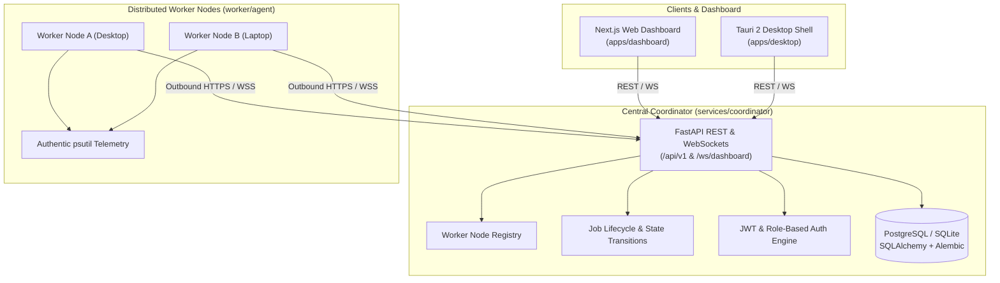

# WebSync AI

**WebSync AI** is a cross-platform distributed computing platform that connects multiple computers over a network and allows them to contribute available CPU, RAM, and supported GPU resources to execute workloads remotely.

---

## Architecture Overview



---

## Monorepo Structure

```text
WebSync_AI/
├── apps/
│   ├── dashboard/          # Next.js 15 web dashboard with Tailwind CSS & live health monitor
│   └── desktop/            # Tauri 2 native desktop application scaffold (Vite + React)
├── services/
│   └── coordinator/        # FastAPI central orchestration service (Auth, Registry, Jobs, DB, WS)
│       ├── alembic/        # Alembic database schema migrations
│       ├── src/coordinator/# Routers, models, schemas, services, and core utilities
│       ├── tests/          # Pytest automated test suite (16 comprehensive tests)
│       └── alembic.ini     # Alembic configuration
├── worker/
│   ├── agent/              # Python worker node agent (psutil telemetry & executor)
│   └── jobs/               # Workload definitions and execution samples
├── packages/
│   ├── shared-types/       # Canonical TypeScript interfaces (Health, Worker, Job, Metrics)
│   ├── api-client/         # Shared typed API client for coordinator communication
│   └── ui/                 # Reusable design tokens, constants, and navigation models
├── infra/
│   ├── docker/             # Docker Compose (PostgreSQL, Coordinator, Dashboard) & Dockerfiles
│   └── deployment/         # Network and cluster deployment guides
├── docs/
│   ├── architecture.md     # In-depth architectural design, networking, and boundaries
│   ├── api.md              # REST & WebSocket protocol specifications
│   └── security.md         # Threat model, token auth, and worker isolation policies
├── .env.example            # Safe environment template
├── .gitignore              # Repository git ignore rules
├── package.json            # Monorepo workspace configuration
├── pnpm-workspace.yaml     # pnpm workspace package definitions
└── pyproject.toml          # Root Python configuration
```

---

## Quickstart Guide

### 1. Environment Setup

Copy the example configuration file:
```bash
cp .env.example .env
```

### 2. Python Dependencies

Activate your virtual environment and install dependencies:
```bash
# On Windows:
.venv\Scripts\activate

# On Linux/macOS:
source .venv/bin/activate

pip install fastapi "uvicorn[standard]" pydantic pydantic-settings httpx sqlalchemy "sqlalchemy[asyncio]" alembic aiosqlite pyjwt bcrypt email-validator psutil pytest pytest-asyncio
```

### 3. Database Migrations

Run Alembic migrations to initialize the SQLite or PostgreSQL database:
```bash
# On Windows:
$env:PYTHONPATH="services/coordinator/src"; alembic -c services/coordinator/alembic.ini upgrade head

# On Linux/macOS:
PYTHONPATH="services/coordinator/src" alembic -c services/coordinator/alembic.ini upgrade head
```

### 4. Run Backend Coordinator

Start the FastAPI coordinator:
```bash
# On Windows:
$env:PYTHONPATH="services/coordinator/src"; python services/coordinator/src/coordinator/main.py

# On Linux/macOS:
PYTHONPATH="services/coordinator/src" python services/coordinator/src/coordinator/main.py
```

- **Interactive Swagger Docs**: `http://localhost:8000/docs`
- **Health Check**: `http://localhost:8000/api/v1/health`
- **Real-Time WebSockets**: `ws://localhost:8000/ws/dashboard`

### 5. Run Worker Agent (Phase 3)

The cross-platform Python worker agent collects real system metrics via `psutil`, dynamically detects NVIDIA GPUs via NVML (`nvidia-ml-py`), registers with the coordinator, and executes sandboxed computational workloads.

#### Inspect Local Machine Telemetry (Standalone)
Inspect genuine system hardware, CPU cores, RAM, and GPU detection without connecting to the coordinator:
```bash
python worker/agent/main.py --inspect
```

#### Single Heartbeat Verification Mode
Perform a one-time registration, send one live telemetry heartbeat, and cleanly disconnect:
```bash
python worker/agent/main.py --coordinator-url http://localhost:8000 --once
```

#### Run Worker Agent as Background Daemon
Connect to the coordinator and begin periodic telemetry heartbeats (default every 10s):
```bash
# On Windows:
$env:PYTHONPATH="worker;.env"; python worker/agent/main.py

# On Linux/macOS:
PYTHONPATH="worker" python worker/agent/main.py
```

CLI options supported:
- `--inspect`: Inspect genuine hardware specs, RAM, CPU cores, and GPU availability, then exit.
- `--once`: Enroll, dispatch a single real telemetry heartbeat to verify connectivity, and disconnect cleanly.
- `--coordinator-url <url>`: Override coordinator endpoint (defaults to `WEB_SYNC_COORDINATOR_URL`).
- `--worker-id <id>`: Override worker node ID (defaults to `WEB_SYNC_WORKER_ID`).
- `--worker-name <name>`: Override node display name (defaults to hostname).

### 6. Run Automated Tests

Execute the complete test suite (58 tests across coordinator scheduler, dispatch, workers, and executor):
```bash
# On Windows:
$env:PYTHONPATH="services/coordinator/src;worker"; pytest services/coordinator/tests worker/tests -v

# On Linux/macOS:
PYTHONPATH="services/coordinator/src:worker" pytest services/coordinator/tests worker/tests -v
```

### 7. Run the Web Dashboard

```bash
npx pnpm --filter @websync/dashboard dev
```
Open `http://localhost:3000` to interact with the dashboard.

---

## Implemented API Endpoints (Phase 2, 3 & 4)

| Method | Endpoint | Description |
| :--- | :--- | :--- |
| `GET` | `/api/v1/health` | Live coordinator uptime, API version, and database connectivity. |
| `POST` | `/api/v1/auth/register` | Register an operator or administrator user account. |
| `POST` | `/api/v1/auth/login` | Authenticate and obtain a JWT bearer access token. |
| `GET` | `/api/v1/auth/me` | Fetch authenticated user profile. |
| `POST` | `/api/v1/workers/register` | Register a new compute worker node with validation and issue worker token. |
| `POST` | `/api/v1/workers/heartbeat` | Ingest real-time CPU, RAM, and active jobs telemetry from worker nodes. |
| `GET` | `/api/v1/workers` | Paginated list of registered workers with stale-heartbeat timeout evaluation. |
| `GET` | `/api/v1/workers/{worker_id}` | Retrieve details for a single worker node. |
| `POST` | `/api/v1/workers/{worker_id}/disconnect` | Mark a worker as disconnected and safely re-queue or fail active jobs. |
| `GET` | `/api/v1/workers/{worker_id}/jobs/pending` | Poll for scheduled jobs assigned to a specific worker. |
| `POST` | `/api/v1/workers/{worker_id}/jobs/{job_id}/ack` | Worker acknowledgement or rejection of dispatched job. |
| `POST` | `/api/v1/workers/{worker_id}/jobs/{job_id}/start` | Worker execution start confirmation (transitions to `RUNNING`). |
| `POST` | `/api/v1/workers/{worker_id}/jobs/{job_id}/result` | Submit completed workload output and execution duration. |
| `POST` | `/api/v1/jobs` | Submit a computational job and trigger adaptive scheduling placement. |
| `GET` | `/api/v1/jobs` | Paginated list of jobs with status and job_type filtering. |
| `GET` | `/api/v1/jobs/{job_id}` | Retrieve job status, requirements, placement reason, and assignment details. |
| `POST` | `/api/v1/jobs/{job_id}/cancel` | Cancel a non-terminal queued, scheduled, or running job and release capacity. |
| `GET` | `/api/v1/jobs/{job_id}/result` | Retrieve execution exit code, duration, and output for a completed job. |
| `PATCH` | `/api/v1/jobs/{job_id}/status` | Update execution status with strict state machine validation. |
| `GET` | `/api/v1/jobs/{job_id}/events` | Retrieve audit history and state transitions for a specific job. |
| `GET` | `/api/v1/events` | Paginated audit trail of all cluster and workload lifecycle events. |
| `WS` | `/ws/dashboard` | WebSocket stream broadcasting `worker.*` and `job.*` event notifications. |
| `WS` | `/ws/worker` | Authenticated worker agent bidirectional WebSocket channel for real-time dispatch. |

---

## WebSync AI Dashboard Views (Phase 5)

WebSync AI features 6 real-time, desktop-first dark-mode views connecting directly to the coordinator:

1. **Overview (`/`)**: Cluster compute pool status, connected node count, active workloads in-flight, pooled RAM gauge, CPU average, and recent workloads preview.
2. **Workers (`/workers`)**: Real-time worker cards with OS platforms (Windows, Linux, macOS), authentic `psutil` CPU/RAM meters, detected GPU hardware, concurrency slots, search, status filter, and node enrollment instructions.
3. **Jobs (`/jobs`)**: Distributed workload table with state badges (`QUEUED`, `SCHEDULED`, `RUNNING`, `COMPLETED`, `FAILED`, `CANCELLED`), workload submission modal, cancellation actions, and result inspection.
4. **Resource Monitor (`/monitor`)**: Time-series CPU load trend chart, pooled memory gauge, detected GPU accelerator inventory, and a worker heartbeat freshness table.
5. **Activity Logs (`/logs`)**: Chronological audit trail stream with event type filters (`CREATED`, `SCHEDULED`, `STARTED`, `COMPLETED`, `FAILED`, `CANCELLED`), timestamp inspection, and JSON details viewer.
6. **Settings (`/settings`)**: Coordinator endpoint configurator with live ping latency test, system runtime metadata, and worker startup commands.

---

## Roadmap

- **Phase 1**: Project Foundation & Architecture *(Completed)*
- **Phase 2**: Backend Coordinator & Job Management *(Completed)*
- **Phase 3**: Cross-Platform Python Worker Agent & Telemetry *(Completed)*
- **Phase 4**: Adaptive Scheduling & Distributed Job Execution *(Completed)*
- **Phase 5**: Dashboard, UI/UX, and Application Navigation *(Completed)*
- **Phase 6**: Security Hardening & Mutual TLS (mTLS)
- **Phase 7**: Cross-Platform Desktop Packaging (Tauri 2)
