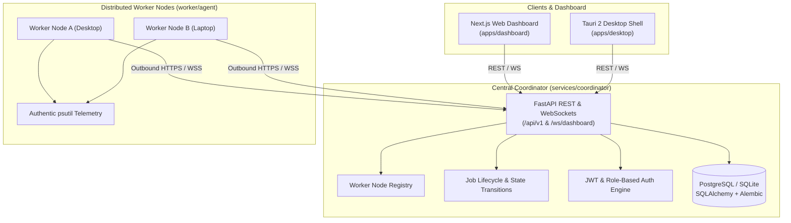

# WebSync AI

**WebSync AI** is a cross-platform distributed computing platform that connects multiple computers over a network and allows them to contribute available CPU, RAM, and supported GPU resources to execute workloads remotely.

---

## Architecture Overview



---

## Monorepo Structure

```text
WebSync_AI/
├── apps/
│   ├── dashboard/          # Next.js 15 web dashboard with Tailwind CSS & live health monitor
│   └── desktop/            # Tauri 2 native desktop application scaffold (Vite + React)
├── services/
│   └── coordinator/        # FastAPI central orchestration service (Auth, Registry, Jobs, DB, WS)
│       ├── alembic/        # Alembic database schema migrations
│       ├── src/coordinator/# Routers, models, schemas, services, and core utilities
│       ├── tests/          # Pytest automated test suite (16 comprehensive tests)
│       └── alembic.ini     # Alembic configuration
├── worker/
│   ├── agent/              # Python worker node agent (psutil telemetry & executor)
│   └── jobs/               # Workload definitions and execution samples
├── packages/
│   ├── shared-types/       # Canonical TypeScript interfaces (Health, Worker, Job, Metrics)
│   ├── api-client/         # Shared typed API client for coordinator communication
│   └── ui/                 # Reusable design tokens, constants, and navigation models
├── infra/
│   ├── docker/             # Docker Compose (PostgreSQL, Coordinator, Dashboard) & Dockerfiles
│   └── deployment/         # Network and cluster deployment guides
├── docs/
│   ├── architecture.md     # In-depth architectural design, networking, and boundaries
│   ├── api.md              # REST & WebSocket protocol specifications
│   └── security.md         # Threat model, token auth, and worker isolation policies
├── .env.example            # Safe environment template
├── .gitignore              # Repository git ignore rules
├── package.json            # Monorepo workspace configuration
├── pnpm-workspace.yaml     # pnpm workspace package definitions
└── pyproject.toml          # Root Python configuration
```

---

## Quickstart Guide

This quickstart uses **Windows PowerShell** and assumes commands are run from the repository root. Use Python 3.12 or newer, Node.js, and pnpm. The local-development database defaults to SQLite (`coordinator.db`); PostgreSQL, Redis, Docker, and a separate database server are not required for this setup.

### 1. Install dependencies

Install JavaScript workspace dependencies from the committed lockfile:

```powershell
pnpm install --frozen-lockfile
```

Create a project-local Python environment if `.venv` does not already exist, then activate it:

```powershell
py -3 -m venv .venv
.\.venv\Scripts\Activate.ps1
```

If `.venv` already exists, skip the creation command and activate it. Install the dependencies declared by the coordinator and worker projects, including their test extras:

```powershell
python -m pip install --upgrade pip
python -m pip install "fastapi>=0.115.0" "uvicorn[standard]>=0.30.0" "pydantic>=2.8.0" "pydantic-settings>=2.4.0" "httpx>=0.27.0" "sqlalchemy>=2.0.0" "alembic>=1.13.0" "aiosqlite>=0.20.0" "pyjwt>=2.8.0" "bcrypt>=4.1.0" "psutil>=6.0.0" "websockets>=12.0.0" "pytest>=8.0.0" "pytest-asyncio>=0.23.0" "pytest-timeout>=2.3.0"
```

NVIDIA GPU telemetry support is optional. To install its additional driver binding:

```powershell
python -m pip install "nvidia-ml-py>=12.0.0"
```

### 2. Prepare local environment files

Keep any existing local configuration. Only copy the examples if the destination files do not already exist:

```powershell
if (-not (Test-Path .env)) { Copy-Item .env.example .env }
if (-not (Test-Path apps\dashboard\.env.local)) { Copy-Item apps\dashboard\.env.example apps\dashboard\.env.local }
```

The root `.env` configures the coordinator and worker, including the local SQLite URL and development worker credentials. The dashboard reads its coordinator and dashboard WebSocket URLs from `apps\dashboard\.env.local`. Never use the example development credentials in production.

### 3. Initialize/update the database schema

Run the checked-in Alembic migrations once before starting the services:

```powershell
python -m alembic -c services\coordinator\alembic.ini upgrade head
```

With the default `.env`, this applies migrations to the local SQLite database. The coordinator also creates missing tables at startup, but applying Alembic migrations is the project’s explicit schema-upgrade command. Do not delete or reset an existing database to start the app.

### 4. Start the coordinator, dashboard, and worker

Run each command in a **separate VS Code integrated terminal**, with the working directory set to the repository root. Keep all three terminals open.

**Terminal 1 — coordinator**

```powershell
$env:PYTHONPATH = "services\coordinator\src"
python -m uvicorn coordinator.main:app --host 0.0.0.0 --port 8000
```

The coordinator listens on port `8000`. `0.0.0.0` allows other machines on a permitted network interface to connect; restrict access with your firewall and do not expose the development HTTP service to the public internet.

- API documentation: `http://localhost:8000/docs`
- Health check: `http://localhost:8000/api/v1/health`
- Dashboard WebSocket: `ws://localhost:8000/ws/dashboard`
- Worker WebSocket: `ws://localhost:8000/ws/worker`

**Terminal 2 — dashboard**

```powershell
pnpm dev:dashboard
```

Open `http://localhost:3000`.

**Terminal 3 — local worker**

```powershell
python worker\agent\main.py
```

The worker reads `WEB_SYNC_COORDINATOR_URL`, `WEB_SYNC_WORKER_ID`, and `WEB_SYNC_WORKER_TOKEN` from the root `.env` (or uses the configured development defaults). Its default coordinator URL is `http://localhost:8000`.

Optional worker checks:

```powershell
python worker\agent\main.py --inspect
python worker\agent\main.py --coordinator-url http://localhost:8000 --once
```

For a worker on another computer, set `WEB_SYNC_COORDINATOR_URL` to the coordinator computer’s reachable LAN IP (for example, `http://192.168.1.50:8000`) and give it a unique worker ID. Permit TCP port 8000 only on a trusted private network. Use HTTPS/WSS or a secured VPN for remote networks; do not expose this development HTTP endpoint publicly.

### 5. Run automated checks

From the repository root, with the Python environment activated:

```powershell
$env:PYTHONPATH = "services\coordinator\src;worker"
python -m pytest services\coordinator\tests worker\tests -v
pnpm type-check
pnpm --filter @websync/dashboard build
```

The dashboard `lint` script currently runs `next lint`, which may prompt to create an ESLint configuration if one is not present.

### 6. Build or run the Tauri desktop app (optional)

Tauri requires Rust/Cargo, WebView2, and Visual Studio C++ Build Tools with a Windows SDK. From the repository root:

```powershell
pnpm --filter @websync/desktop exec tauri dev
pnpm --filter @websync/desktop exec tauri build
```

The Tauri configuration starts its Vite frontend on port `1420`. Run one Tauri command at a time; it manages the frontend process itself.

---

## Implemented API Endpoints (Phase 2, 3 & 4)

| Method | Endpoint | Description |
| :--- | :--- | :--- |
| `GET` | `/api/v1/health` | Live coordinator uptime, API version, and database connectivity. |
| `POST` | `/api/v1/auth/register` | Register an operator or administrator user account. |
| `POST` | `/api/v1/auth/login` | Authenticate and obtain a JWT bearer access token. |
| `GET` | `/api/v1/auth/me` | Fetch authenticated user profile. |
| `POST` | `/api/v1/workers/register` | Register a new compute worker node with validation and issue worker token. |
| `POST` | `/api/v1/workers/heartbeat` | Ingest real-time CPU, RAM, and active jobs telemetry from worker nodes. |
| `GET` | `/api/v1/workers` | Paginated list of registered workers with stale-heartbeat timeout evaluation. |
| `GET` | `/api/v1/workers/{worker_id}` | Retrieve details for a single worker node. |
| `POST` | `/api/v1/workers/{worker_id}/disconnect` | Mark a worker as disconnected and safely re-queue or fail active jobs. |
| `GET` | `/api/v1/workers/{worker_id}/jobs/pending` | Poll for scheduled jobs assigned to a specific worker. |
| `POST` | `/api/v1/workers/{worker_id}/jobs/{job_id}/ack` | Worker acknowledgement or rejection of dispatched job. |
| `POST` | `/api/v1/workers/{worker_id}/jobs/{job_id}/start` | Worker execution start confirmation (transitions to `RUNNING`). |
| `POST` | `/api/v1/workers/{worker_id}/jobs/{job_id}/result` | Submit completed workload output and execution duration. |
| `POST` | `/api/v1/jobs` | Submit a computational job and trigger adaptive scheduling placement. |
| `GET` | `/api/v1/jobs` | Paginated list of jobs with status and job_type filtering. |
| `GET` | `/api/v1/jobs/{job_id}` | Retrieve job status, requirements, placement reason, and assignment details. |
| `POST` | `/api/v1/jobs/{job_id}/cancel` | Cancel a non-terminal queued, scheduled, or running job and release capacity. |
| `GET` | `/api/v1/jobs/{job_id}/result` | Retrieve execution exit code, duration, and output for a completed job. |
| `PATCH` | `/api/v1/jobs/{job_id}/status` | Update execution status with strict state machine validation. |
| `GET` | `/api/v1/jobs/{job_id}/events` | Retrieve audit history and state transitions for a specific job. |
| `GET` | `/api/v1/events` | Paginated audit trail of all cluster and workload lifecycle events. |
| `WS` | `/ws/dashboard` | WebSocket stream broadcasting `worker.*` and `job.*` event notifications. |
| `WS` | `/ws/worker` | Authenticated worker agent bidirectional WebSocket channel for real-time dispatch. |

---

## WebSync AI Dashboard Views (Phase 5)

WebSync AI features 6 real-time, desktop-first dark-mode views connecting directly to the coordinator:

1. **Overview (`/`)**: Cluster compute pool status, connected node count, active workloads in-flight, pooled RAM gauge, CPU average, and recent workloads preview.
2. **Workers (`/workers`)**: Real-time worker cards with OS platforms (Windows, Linux, macOS), authentic `psutil` CPU/RAM meters, detected GPU hardware, concurrency slots, search, status filter, and node enrollment instructions.
3. **Jobs (`/jobs`)**: Distributed workload table with state badges (`QUEUED`, `SCHEDULED`, `RUNNING`, `COMPLETED`, `FAILED`, `CANCELLED`), workload submission modal (including **Remote AI Prompt Execution** with Ollama), cancellation actions, and result inspection.
4. **Resource Monitor (`/monitor`)**: Time-series CPU load trend chart, pooled memory gauge, detected GPU accelerator inventory, and a worker heartbeat freshness table.
5. **Activity Logs (`/logs`)**: Chronological audit trail stream with event type filters (`CREATED`, `SCHEDULED`, `STARTED`, `COMPLETED`, `FAILED`, `CANCELLED`), timestamp inspection, and JSON details viewer.
6. **Settings (`/settings`)**: Coordinator endpoint configurator with live ping latency test, system runtime metadata, and worker startup commands.

---

## Remote AI Prompt Execution with Ollama

WebSync AI enables operators to submit natural language prompts from the dashboard, dispatch them via the coordinator's adaptive scheduler to online worker PCs running [Ollama](https://ollama.com), execute them using local open-weight models (e.g. `llama3.2:latest`, `mistral:latest`), and stream structured results back in real time.

For full setup instructions and architecture details, see the guide in [`docs/remote_ai_execution.md`](docs/remote_ai_execution.md).

---

## Hackathon Demonstration & Release Readiness (Phase 9)

WebSync AI is verified and release-ready for hackathon evaluation:

- **10-Step Interactive Demo:** See [`docs/HACKATHON_DEMO.md`](docs/HACKATHON_DEMO.md) for full commands and walkthrough.
- **Release Checklist & SLA Verification:** See [`docs/RELEASE_CHECKLIST.md`](docs/RELEASE_CHECKLIST.md).
- **Single-Command End-to-End Validation:**
  ```powershell
  python scripts/phase9_system_validation.py
  ```
  Executes verifiable matrix multiplication workload ($A \times B$), tests adaptive scheduling under high CPU/RAM/GPU constraints, validates terminal state immutability, tests worker disconnect recovery, and measures live sub-100ms dispatch latencies in under 3 seconds.

### Verified Hardware Benchmarks (Live Run)
- **Coordinator Startup:** 0.80 s
- **Worker Registration Latency:** 40.90 ms
- **Heartbeat RTT:** 24.22 ms
- **WebSocket Dispatch Latency:** 66.56 ms
- **Workload Execution ($2\times2$ Matrix Multiplication):** 0.0118 s
- **End-to-End Job Completion:** 0.0789 s (78.9 ms)
- **Idle Worker RSS:** 106.03 MB (0.0% CPU)

---

## Roadmap

- **Phase 1**: Project Foundation & Architecture *(Completed)*
- **Phase 2**: Backend Coordinator & Job Management *(Completed)*
- **Phase 3**: Cross-Platform Python Worker Agent & Telemetry *(Completed)*
- **Phase 4**: Adaptive Scheduling & Distributed Job Execution *(Completed)*
- **Phase 5**: Dashboard, UI/UX, and Application Navigation *(Completed)*
- **Phase 6**: Real-Time Communication & End-to-End Synchronization *(Completed)*
- **Phase 7**: Security Hardening & Reliability *(Completed)*
- **Phase 8**: Cross-Platform Desktop Packaging (Tauri 2 & PyInstaller) *(Completed)*
- **Phase 9**: End-to-End Validation, Performance, & Hackathon Readiness *(Completed)*
