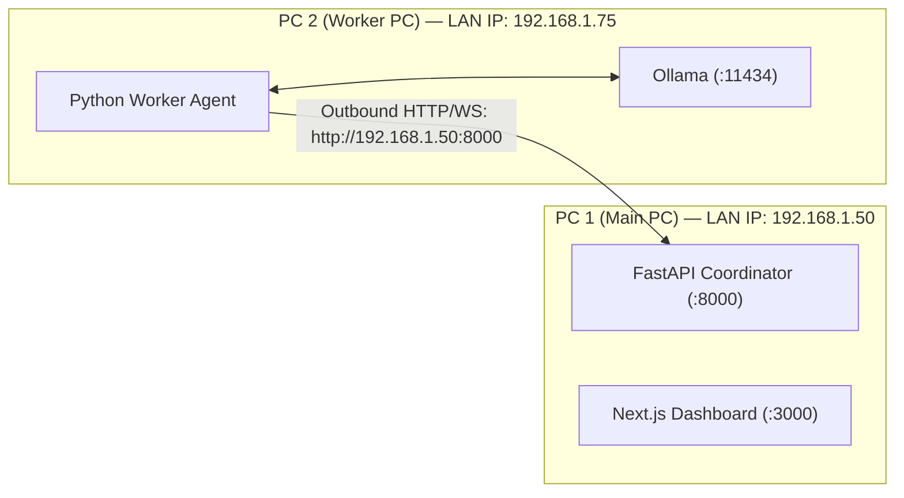

# WebSync AI — Two-PC Connection & Remote AI Prompt Execution Guide

**WebSync AI** is a distributed computing platform designed to connect multiple computers across local networks (LAN) or the public internet (WAN). It enables you to submit tasks—such as natural-language AI prompts—from one computer (**PC 1**) and execute them using computational hardware (CPU, RAM, GPU, or local Ollama models) on a separate computer (**PC 2**), returning the output directly to your screen.

This guide walks you step-by-step through setting up, connecting, and running remote AI tasks between two computers.

---

## 1. What WebSync AI Does

WebSync AI operates as an orchestrated distributed system consisting of four primary components:

1. **Central Coordinator (FastAPI)**: The authoritative control plane. It manages worker node registrations, authenticates connections, tracks live hardware telemetry, runs the multi-criteria adaptive scheduler, stores job history in PostgreSQL or SQLite, and streams events over WebSockets.
2. **Web Dashboard (Next.js 15)**: The graphical user interface running in your browser on PC 1. It displays real-time cluster health, active nodes, hardware utilization meters, a workload submission modal, and execution logs.
3. **Worker Agent (Python)**: A lightweight daemon running on PC 2 (and any other worker nodes). It samples host hardware via non-blocking `psutil` and GPU libraries, discovers local AI models running in Ollama, initiates an outbound WebSocket connection to the coordinator, and executes approved workloads.
4. **Adaptive Scheduler & Handlers**: When a job is submitted, the scheduler scores candidate workers based on CPU load, available RAM, and hardware capabilities. For AI tasks (`llm_prompt`), it matches the requested model against the worker's locally installed Ollama models.

> [!IMPORTANT]
> **What WebSync AI Is and Is Not:**
> - WebSync AI **dispatches and executes whole tasks** on designated worker nodes.
> - Connecting PC 2 to PC 1 does **not** merge or pool physical RAM into a single unified operating system memory space (e.g. connecting two 16 GB PCs does not give your Windows desktop 32 GB of system RAM). Instead, it lets PC 1 offload intensive workloads (like AI inference or matrix math) to PC 2's hardware over the network.

---

## 2. Requirements for Both PCs

### PC 1: Operator Workstation (Main PC)
- **Role**: Runs the web dashboard in a browser, accesses the coordinator REST API/WebSockets, submits prompts, and views results.
- **Operating System**: Windows 10/11, macOS, or Linux.
- **Software**: Modern web browser (Chrome, Edge, Firefox, Brave, Safari).
- **Node.js (if hosting dashboard locally)**: Node.js 20 or 22, and `pnpm@9.15.4`.
- **Network**: Internet access or local network connection to the coordinator.

### PC 2: Worker Node (Compute & AI Workstation)
- **Role**: Hosts the Python worker agent and local AI inference engine (Ollama).
- **Operating System**: Windows 10/11 (64-bit), Ubuntu/Debian/Fedora Linux, or macOS (Apple Silicon M-series or Intel).
- **Python**: Python 3.11, 3.12, or 3.13.
- **Hardware Recommendations for AI Inference**:
  - **1B to 3B models** (`llama3.2:1b`, `llama3.2:3b`): Minimum 8 GB RAM. Dedicated GPU optional.
  - **7B to 8B models** (`llama3:latest`, `mistral:latest`): Minimum 16 GB RAM or NVIDIA GPU with 6+ GB VRAM.
- **Ollama**: Installed locally on PC 2 (download from [ollama.com](https://ollama.com)).
- **Network**: Outbound HTTPS and WebSocket access to the coordinator. **No inbound port forwarding or public router openings required.**

---

## 3. Recommended Topologies

### Topology A: Different Internet Networks / Cross-WAN (Production Mode)

```mermaid
flowchart TD
    subgraph Net1["Network 1 (e.g., Home Wi-Fi)"]
        PC1["PC 1 (Operator Workstation)\nOpens Web Dashboard in Browser"]
    end

    subgraph Cloud["Railway Cloud / VPS (Public HTTPS & WSS)"]
        Coord["WebSync AI Coordinator\n(FastAPI / Uvicorn on 0.0.0.0:$PORT)"]
        DB[(PostgreSQL Database)]
        Dash["Next.js Web Dashboard Service"]
        Coord <--> DB
        Dash -.-> Coord
    end

    subgraph Net2["Network 2 (e.g., Office / Mobile Hotspot)"]
        PC2["PC 2 (Compute Node)\nWorker Agent (Python)"]
        Ollama["Ollama Local Daemon\nhttp://localhost:11434"]
        PC2 <--> Ollama
    end

    PC1 -->|HTTPS / WSS| Dash
    PC1 -->|REST API| Coord
    PC2 -->|Outbound TLS WebSocket (WSS)| Coord
```

- **Coordinator**: Deployed to a publicly accessible HTTPS/WSS service (such as Railway).
- **PC 1**: Connects to the public dashboard and coordinator.
- **PC 2**: Initiates an outbound WebSocket to the public coordinator URL. Since the connection is outbound from PC 2, firewalls and routers allow it automatically without port forwarding.

---

### Topology B: Same Local Network / LAN Demo Mode



- **Coordinator**: Runs on PC 1, listening on `0.0.0.0:8000`.
- **PC 2**: Connects directly to PC 1's LAN IP address (`http://192.168.1.50:8000`).

---

## 4. Local Same-Network (LAN) Setup Walkthrough

### Step 1: Find PC 1's Local IP Address
On PC 1, open PowerShell and run:
```powershell
ipconfig
```
Look for **IPv4 Address** under your active Wi-Fi or Ethernet adapter (e.g., `192.168.1.50`).

### Step 2: Start Coordinator on PC 1
On PC 1, from the `WebSync_AI` repository root:
```powershell
# Activate Python environment
.\.venv\Scripts\Activate.ps1

# Start coordinator listening on all interfaces
python -m uvicorn coordinator.main:app --host 0.0.0.0 --port 8000
```

### Step 3: Configure PC 1 Windows Firewall
Allow incoming connections on port 8000 for private networks:
```powershell
New-NetFirewallRule -DisplayName "WebSync AI Coordinator" -Direction Inbound -LocalPort 8000 -Protocol TCP -Action Allow -Profile Private
```

### Step 4: Start Dashboard on PC 1
In a second terminal on PC 1:
```powershell
# Start Next.js development server
pnpm --filter @websync/dashboard dev
```
Open `http://localhost:3000` in your browser.

### Step 5: Start Ollama on PC 2
On PC 2, open a terminal:
```bash
# Verify Ollama is running
ollama serve
```
In another terminal, pull a model:
```bash
ollama pull llama3.2:latest
```

### Step 6: Start Worker Agent on PC 2
On PC 2, clone or copy the `WebSync_AI` repository, activate the Python virtual environment, and launch:
```powershell
# Replace 192.168.1.50 with PC 1's actual IP address
python -m worker.agent.main `
  --coordinator-url http://192.168.1.50:8000 `
  --worker-id node-pc2-workstation `
  --worker-name "PC2-Compute-Rig" `
  --token test-dev-worker-token
```
PC 2 will discover `llama3.2:latest` from its local Ollama instance and register with PC 1.

---

## 5. Different-Network (Cross-WAN) Setup with Railway

When PC 1 and PC 2 are on completely different internet connections, host the coordinator publicly on Railway.

### Deployment Summary
1. **PostgreSQL**: Deploy Railway PostgreSQL plugin.
2. **Coordinator**: Deploy from `infra/docker/Dockerfile.coordinator` on Railway.
   - Set `ENVIRONMENT=production`.
   - Set `DATABASE_URL=${{Postgres.DATABASE_URL}}`.
   - Set `WORKER_DEV_AUTH_TOKEN=<CHOOSE_A_SECURE_TOKEN>`.
   - Railway assigns a public URL, e.g.: `https://websync-coordinator.up.railway.app`.
3. **Dashboard**: Deploy Next.js on Railway (or run locally on PC 1 pointing to the Railway coordinator):
   - Set `NEXT_PUBLIC_API_URL=https://websync-coordinator.up.railway.app`.
   - Set `NEXT_PUBLIC_WS_URL=wss://websync-coordinator.up.railway.app/ws/dashboard`.

### Connecting PC 2 from Another Network
On PC 2 (connected to home Wi-Fi, office network, or mobile hotspot):
```powershell
python -m worker.agent.main `
  --coordinator-url https://websync-coordinator.up.railway.app `
  --worker-id remote-pc2-gpu `
  --worker-name "PC2-Remote-Workstation" `
  --token <YOUR_SECURE_TOKEN>
```
1. PC 2 dials outbound HTTPS to register.
2. PC 2 establishes an outbound persistent WSS connection (`wss://websync-coordinator.up.railway.app/ws/worker`).
3. Since PC 2 initiated the outbound connection, no router ports need to be forwarded on PC 2.

---

## 6. Ollama Setup on PC 2

### 1. Installation
- **Windows**: Download and run the installer from [ollama.com/download/windows](https://ollama.com/download/windows).
- **macOS**: Download from [ollama.com/download/mac](https://ollama.com/download/mac).
- **Linux**: Run:
  ```bash
  curl -fsSL https://ollama.com/install.sh | sh
  ```

### 2. Downloading Compatible Models
Choose a model suited to PC 2's hardware:
```bash
# For laptops or computers with 8 GB to 16 GB RAM (Fast, low resource consumption)
ollama pull llama3.2:latest
ollama pull llama3.2:1b

# For workstations with 16+ GB RAM or dedicated GPUs (High capability)
ollama pull mistral:latest
ollama pull phi3:latest
ollama pull gemma2:latest
```

### 3. Verify Local API Availability
On PC 2, check that the local Ollama API is responding:
```bash
curl http://localhost:11434/api/tags
```
Expected output: A JSON object containing your downloaded models:
```json
{"models":[{"name":"llama3.2:latest",...}]}
```

> [!CAUTION]
> **Keep Ollama Local:** Never bind Ollama's port to `0.0.0.0` or open port 11434 on your router. WebSync AI's worker agent communicates with Ollama strictly via `localhost` and relays authenticated tasks securely.

---

## 7. Exact Environment Configuration

### Summary Table

| Variable | Used By | Example Value | Description |
| :--- | :--- | :--- | :--- |
| `ENVIRONMENT` | Coordinator | `production` or `development` | Operating mode |
| `COORDINATOR_HOST` | Coordinator | `0.0.0.0` | Bind interface |
| `PORT` | Coordinator | `8000` | Port assigned by host/Railway |
| `DATABASE_URL` | Coordinator | `postgresql+asyncpg://...` | Connection string |
| `COORDINATOR_SECRET_KEY` | Coordinator | `32+ random characters` | JWT token signing key |
| `WORKER_DEV_AUTH_TOKEN` | Coordinator & Worker | `secure-shared-worker-token` | Pre-shared worker enrollment secret |
| `NEXT_PUBLIC_API_URL` | Dashboard (PC 1) | `https://coordinator.railway.app` | Coordinator REST base URL |
| `NEXT_PUBLIC_WS_URL` | Dashboard (PC 1) | `wss://coordinator.railway.app/ws/dashboard` | Coordinator dashboard WebSocket URL |
| `WEB_SYNC_COORDINATOR_URL` | Worker (PC 2) | `https://coordinator.railway.app` | Coordinator endpoint for worker |
| `WEB_SYNC_WORKER_ID` | Worker (PC 2) | `node-pc2-workstation` | Unique node identifier |
| `WEB_SYNC_WORKER_NAME` | Worker (PC 2) | `PC2 Workstation` | Human-readable node display name |
| `WEB_SYNC_WORKER_TOKEN` | Worker (PC 2) | `secure-shared-worker-token` | Pre-shared secret matching coordinator |
| `WEB_SYNC_OLLAMA_URL` | Worker (PC 2) | `http://localhost:11434` | Local Ollama endpoint |
| `OLLAMA_TIMEOUT_SECONDS` | Worker (PC 2) | `300` | Maximum inference generation timeout |

---

## 8. How to Send a Prompt from PC 1 to PC 2

### Method 1: Using the Web Dashboard (Recommended)

1. Open the dashboard on PC 1 (`http://localhost:3000` or your deployed URL).
2. Go to **Connected Nodes (`/workers`)**:
   - Verify that **PC 2** appears with status `online` and lists installed models (e.g., `llama3.2:latest`).
3. Navigate to **Jobs (`/jobs`)** and click **Submit Computational Job**.
4. Configure the job modal:
   - **Workload Type**: Select **`llm_prompt (Remote AI Inference)`**.
   - **Job Name**: Enter a descriptive name (e.g., `Explain Distributed Systems`).
   - **Target Worker Node**: Select **PC 2** from the dropdown (or leave as `⚡ Auto-Assign`).
   - **Inference Model**: Select `llama3.2:latest`.
   - **Prompt**: Type your prompt, for example:
     > *"Explain how distributed systems handle node failures in three bullet points."*
   - **System Prompt (Optional)**: *"You are an expert distributed systems engineer."*
   - **Temperature**: `0.7`
5. Click **Send AI Prompt**.
6. **Watch Real-Time Execution**:
   - Status transitions: `QUEUED` $\to$ `SCHEDULED` $\to$ `RUNNING` $\to$ `COMPLETED`.
   - Click on the job to inspect the generated response, latency in seconds, and token generation count.
   - Click **Copy Response** to copy the generated text.

---

### Method 2: Using the REST API via cURL

You can also submit the prompt directly via cURL from PC 1:

```bash
curl -X POST "http://<COORDINATOR-URL>/api/v1/jobs" \
  -H "Content-Type: application/json" \
  -d '{
    "name": "Explain Microservices",
    "job_type": "llm_prompt",
    "input_payload": {
      "prompt": "What are microservices in two sentences?",
      "model": "llama3.2:latest",
      "temperature": 0.5,
      "target_worker_id": "node-pc2-workstation"
    },
    "requirements": {
      "model": "llama3.2:latest",
      "target_worker_id": "node-pc2-workstation",
      "timeout_seconds": 60
    }
  }'
```

Query the result when finished:
```bash
curl "http://<COORDINATOR-URL>/api/v1/jobs/<JOB_ID>/result"
```

---

## 9. Troubleshooting & Diagnostics

### 1. PC 2 fails to connect: `ConnectionRefusedError` or `HTTP Connection Error`
- **Cause**: The worker on PC 2 cannot reach the coordinator URL, or the coordinator process is not running.
- **Diagnostic**: On PC 2, test basic HTTP connectivity:
  ```powershell
  curl http://<COORDINATOR_IP_OR_URL>/health
  ```
- **Fix**: Check that the coordinator is running and listening on `0.0.0.0` (not `127.0.0.1`), and verify that firewalls allow port 8000.

### 2. `The executable 'pnpm' could not be found` (Railway Build)
- **Cause**: Using Nixpacks or a custom build command on Railway without pnpm installed in the container path.
- **Fix**: In Railway service settings, leave the **Build Command** blank when using Dockerfiles. If using Nixpacks, ensure `nixpacks.toml` runs `cmds = ["npm install -g pnpm@9.15.4"]` in `[phases.setup]`.

### 3. PC 2 shows `online` but no models appear in dropdown
- **Cause**: Ollama is not running on PC 2, or no models have been pulled yet.
- **Diagnostic**: On PC 2, run:
  ```bash
  curl http://localhost:11434/api/tags
  ```
- **Fix**: Run `ollama serve` and `ollama pull llama3.2:latest`. PC 2 will detect the models and advertise them in its next heartbeat (sent every 10 seconds).

### 4. Job fails with `Ollama inference engine is not reachable on this node`
- **Cause**: The Ollama background service stopped or crashed on PC 2.
- **Fix**: Restart Ollama on PC 2: `ollama serve`.

### 5. Job status stays `QUEUED` without scheduling
- **Cause**: The requested model (e.g., `mistral:latest`) is not installed on any online worker, or the target worker specified by `target_worker_id` is offline.
- **Diagnostic**: Inspect the job in the dashboard or query `GET /api/v1/jobs/{job_id}` to check `placement_reason`.
- **Fix**: Pull the model on PC 2 (`ollama pull <model>`) or target an online worker that has the model.

---

## 10. Security Checklist

- [x] **TLS Encryption**: All public internet connections use HTTPS (`https://`) and secure WebSockets (`wss://`).
- [x] **No Inbound Open Ports on Worker**: PC 2 initiates outbound connections only. No home/router port forwarding is needed.
- [x] **Safe Workload Execution**: Prompts are executed strictly via the Ollama JSON API. They are **never** executed as arbitrary shell strings or evaluated as Python code.
- [x] **Credential Isolation**: Pre-shared enrollment secrets and JWT tokens are stored in environment variables, never hardcoded in frontend bundles.
- [x] **Strict Input Bounds**: Prompts are limited to a maximum of 32,768 characters, and models must match valid identifier patterns.
- [x] **Worker Result Verification**: The coordinator validates that only the worker assigned to a job can submit results for it.

---

## 11. End-to-End Verification Checklist

Perform this checklist to verify your multi-computer setup:

- [ ] **Step 1**: Start the coordinator and confirm health: `curl http://<COORDINATOR-URL>/health` returns `{"status": "healthy"}`.
- [ ] **Step 2**: Start Ollama on PC 2: `curl http://localhost:11434/api/tags` lists at least one model.
- [ ] **Step 3**: Start the worker agent on PC 2: console logs confirm `Worker registered successfully` and `WebSocket connected`.
- [ ] **Step 4**: Open the dashboard on PC 1: PC 2 appears in `/workers` with state `online` and lists your Ollama model.
- [ ] **Step 5**: Submit an `llm_prompt` job targeting PC 2.
- [ ] **Step 6**: Verify that PC 2's worker agent logs show receipt of the job and invocation of the local Ollama API.
- [ ] **Step 7**: Verify that PC 1's dashboard transitions the job to `COMPLETED` and renders the real generated response, model badge, and execution time.
- [ ] **Step 8**: Simulate disconnect: Stop the worker on PC 2 and confirm that PC 1's dashboard marks the node `offline` after the heartbeat timeout expires.
