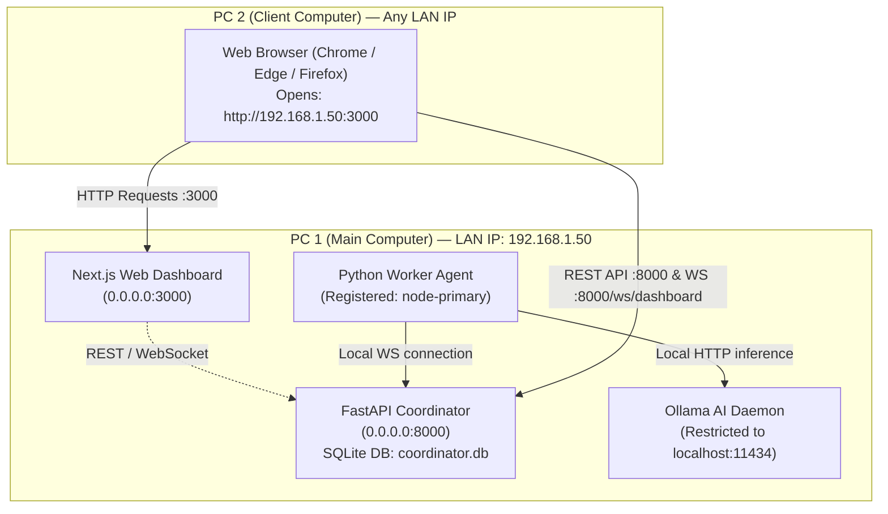
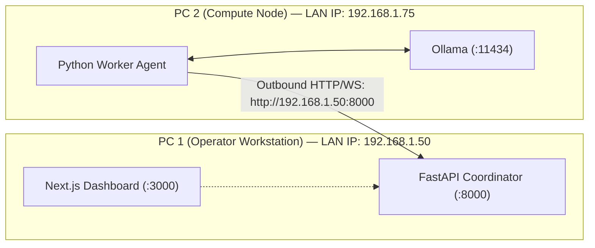

# WebSync AI — Two-PC Connection & Remote AI Prompt Execution Guide

**WebSync AI** is a distributed computing platform designed to connect multiple computers across local networks (LAN) or the public internet (WAN). It enables you to orchestrate workloads—such as natural-language AI prompts—and execute them across computational hardware (CPU, RAM, GPU, or local Ollama models).

This guide walks you step-by-step through setting up, connecting, and running remote AI tasks between two computers on a **local Windows LAN**.

---

## 1. Topologies

### Topology 1: PC 1 as Full Server & AI Host + PC 2 as Client Browser (Recommended)

In this configuration, **PC 1** handles all server infrastructure, database persistence, worker compute, and AI inference. **PC 2** acts as a thin client workstation that interacts with WebSync AI purely through a web browser.



- **PC 1**: Runs FastAPI Coordinator (`:8000`), Next.js Dashboard (`:3000`), Python Worker Agent, and local Ollama (`:11434`).
- **PC 2**: Requires **no Python, no Node.js, and no installations**. Opens `http://<PC1-IP>:3000` in any web browser, submits prompts, and displays results generated by PC 1.
- **Security**: Ollama remains strictly bound to `localhost:11434` on PC 1 and is never exposed directly to the LAN.

---

### Topology 2: PC 1 as Operator Workstation + PC 2 as Worker Compute Node

In this alternative configuration, PC 1 hosts the coordinator and web dashboard, while PC 2 acts as a dedicated compute node hosting the Python worker agent and local Ollama models.



---

## 2. Requirements

### PC 1: Main Computer (Server & AI Host)
- **Operating System**: Windows 10/11 (64-bit).
- **Python**: Python 3.11, 3.12, or 3.13 (virtual environment `.venv`).
- **Node.js**: Node.js 20 or 22 with `pnpm@9.15.4`.
- **Ollama**: Installed locally on PC 1 (from [ollama.com](https://ollama.com)).
- **Hardware**: Sufficient RAM / VRAM for your selected model (e.g. 8+ GB RAM for `llama3.2:1b` or `llama3.2:3b`, or Ollama Cloud).
- **Network**: Connected to the private Wi-Fi or Ethernet network.

### PC 2: Client Computer
- **Operating System**: Windows, macOS, Linux, or iPad/tablet.
- **Software**: Any modern browser (Chrome, Edge, Firefox, Brave, Safari).
- **Network**: Connected to the same private Wi-Fi or Ethernet network as PC 1.

---

## 3. Step-by-Step Setup for Topology 1 (PC 1 Server + PC 2 Browser)

### Step 1: Find PC 1's LAN IPv4 Address
On **PC 1**, open PowerShell and run:
```powershell
ipconfig
```
Look for the **IPv4 Address** under your active Wi-Fi or Ethernet adapter (for example: `192.168.1.50`). Note this IP address down.

---

### Step 2: Configure PC 1 Windows Firewall
Allow inbound private-network TCP connections for the coordinator (port 8000) and dashboard (port 3000).

On **PC 1**, open PowerShell as Administrator and run:
```powershell
# Allow Next.js Dashboard on Port 3000
New-NetFirewallRule -DisplayName "WebSync AI Dashboard (Port 3000)" -Direction Inbound -LocalPort 3000 -Protocol TCP -Action Allow -Profile Private

# Allow FastAPI Coordinator API & WebSockets on Port 8000
New-NetFirewallRule -DisplayName "WebSync AI Coordinator (Port 8000)" -Direction Inbound -LocalPort 8000 -Protocol TCP -Action Allow -Profile Private
```
> [!NOTE]
> Do **not** open port 11434. Ollama remains local to PC 1 on `localhost:11434`.

---

### Step 3: Start Ollama on PC 1
On **PC 1**, open a terminal:
```bash
# Verify Ollama daemon is running
ollama serve
```
In a second terminal, verify that an open model is downloaded (or pull one):
```bash
ollama list
# If no model is installed, pull a lightweight model:
ollama pull llama3.2:latest
```

---

### Step 4: Start the Coordinator on PC 1
On **PC 1**, navigate to the project directory and run:
```powershell
# Set Python path to include coordinator and worker packages
$env:PYTHONPATH="services/coordinator/src;worker;."

# Start FastAPI Coordinator listening on 0.0.0.0 (all network interfaces)
.\.venv\Scripts\python.exe -m uvicorn coordinator.main:app --host 0.0.0.0 --port 8000
```
Verify that the output shows:
```
INFO:     Uvicorn running on http://0.0.0.0:8000 (Press CTRL+C to quit)
INFO:     CORS origins configured: ...
```

---

### Step 5: Start the Python Worker Agent on PC 1
On **PC 1**, open another PowerShell terminal and launch the worker agent:
```powershell
$env:PYTHONPATH="services/coordinator/src;worker;."

.\.venv\Scripts\python.exe -m worker.agent.main `
  --coordinator-url http://localhost:8000 `
  --worker-id node-primary-pc1 `
  --worker-name "PC1-AI-Engine" `
  --token test-dev-worker-token
```
The console will log:
```
[INFO] [worker-agent] Worker registered successfully with coordinator. Worker ID: node-primary-pc1
[INFO] [worker-agent] Connected to coordinator WebSocket at ws://localhost:8000/ws/worker
```
The worker will automatically detect your local Ollama models (e.g. `llama3.2:latest`) and advertise them in its hardware capabilities.

---

### Step 6: Start the Dashboard on PC 1
On **PC 1**, open another terminal:
```powershell
pnpm --filter @websync/dashboard dev
```
Next.js will output:
```
   ▲ Next.js 15.5.27
   - Local:        http://localhost:3000
   - Network:      http://192.168.1.50:3000
 ✓ Ready in 2.4s
```

---

### Step 7: Open the Dashboard on PC 2
On **PC 2**, open your browser (Chrome, Edge, Firefox) and navigate to:
```
http://192.168.1.50:3000
```
*(Replace `192.168.1.50` with PC 1's actual LAN IPv4 address).*

1. The WebSync AI Dashboard will load on PC 2 with its full dark UI.
2. The client-side dashboard automatically resolves PC 1's LAN address (`http://192.168.1.50:8000` and `ws://192.168.1.50:8000/ws/dashboard`).
3. Click on **Connected Nodes (`/workers`)** in the sidebar. You will see **`PC1-AI-Engine`** (`node-primary-pc1`) displayed as **online** with real CPU, RAM, and GPU telemetry.

---

### Step 8: Submit a Remote AI Prompt from PC 2
1. On PC 2's browser, navigate to **Jobs (`/jobs`)** and click **Submit Computational Job**.
2. Set the modal options:
   - **Workload Type**: Select **`llm_prompt (Remote AI Inference)`**.
   - **Job Name**: `Test LAN AI Prompt`.
   - **Target Worker Node**: Select `PC1-AI-Engine (node-primary-pc1)`.
   - **Inference Model**: Select your model (e.g., `llama3.2:latest` or `gemma4:31b`).
   - **Prompt**: Type your natural language prompt:
     > *"Explain why distributed computing is useful in two clear sentences."*
3. Click **Send AI Prompt**.
4. **Watch Real-Time Execution**:
   - The job is dispatched from PC 2's browser to PC 1's coordinator.
   - PC 1's coordinator sends the workload to PC 1's worker agent.
   - PC 1's worker invokes Ollama locally, streams tokens, and returns the finished response.
   - PC 2's dashboard updates in real-time to **`COMPLETED`**.
5. Click on the completed job card on PC 2 to view the **Job Results Modal**:
   - The full AI response text is displayed.
   - Generation latency and token evaluation counts are shown.

---

## 4. Environment Variables Reference

| Variable | Used By | Local LAN Value | Description |
| :--- | :--- | :--- | :--- |
| `COORDINATOR_HOST` | PC 1 Coordinator | `0.0.0.0` | Binds to all network interfaces |
| `COORDINATOR_PORT` / `PORT` | PC 1 Coordinator | `8000` | Port for REST API and WebSockets |
| `DATABASE_URL` | PC 1 Coordinator | `sqlite+aiosqlite:///./coordinator.db` | Local SQLite database |
| `COORDINATOR_ALLOWED_ORIGINS` | PC 1 Coordinator | `http://localhost:3000,...` | Allowed CORS origins (LAN IPs automatically matched via regex) |
| `WEB_SYNC_COORDINATOR_URL` | PC 1 Worker | `http://localhost:8000` | Local coordinator endpoint |
| `WEB_SYNC_OLLAMA_URL` | PC 1 Worker | `http://localhost:11434` | Local Ollama daemon endpoint |
| `NEXT_PUBLIC_COORDINATOR_URL` | PC 2 Browser | Auto-detected | Defaults to `http://<current-host>:8000` when accessed over LAN |
| `NEXT_PUBLIC_WS_URL` | PC 2 Browser | Auto-detected | Defaults to `ws://<current-host>:8000/ws/dashboard` when accessed over LAN |

---

## 5. Troubleshooting & Diagnostics

### 1. PC 2 cannot open `http://<PC1-IP>:3000` ("Site can't be reached")
- **Cause**: Windows Firewall on PC 1 is blocking port 3000, or PC 1 and PC 2 are on different Wi-Fi networks (e.g. guest network isolation).
- **Diagnostic**: On PC 2, open PowerShell or terminal and test port connectivity:
  ```powershell
  Test-NetConnection -ComputerName <PC1-IP> -Port 3000
  ```
- **Fix**: Run the firewall command on PC 1 (from Step 2). Ensure both PCs are connected to the same Wi-Fi SSID and that network profile is set to **Private**.

### 2. Dashboard loads on PC 2, but status shows "Disconnected" from Coordinator
- **Cause**: Windows Firewall is blocking port 8000 on PC 1.
- **Diagnostic**: In PC 2's browser, open `http://<PC1-IP>:8000/api/v1/health` directly. You should see:
  ```json
  {"status":"healthy","service":"websync-coordinator",...}
  ```
- **Fix**: Allow port 8000 in PC 1's Windows Firewall:
  ```powershell
  New-NetFirewallRule -DisplayName "WebSync AI Coordinator" -Direction Inbound -LocalPort 8000 -Protocol TCP -Action Allow -Profile Private
  ```

### 3. Worker on PC 1 does not show up in the Connected Nodes list
- **Cause**: Worker agent is not running on PC 1 or failed to authenticate.
- **Fix**: Check PC 1 worker console logs. Run `python -m worker.agent.main --inspect` to verify that hardware telemetry is readable.

### 4. Submitted `llm_prompt` job fails with `Ollama inference engine is not reachable`
- **Cause**: Ollama is not running on PC 1.
- **Diagnostic**: On PC 1, run `curl http://localhost:11434/api/tags`.
- **Fix**: Launch `ollama serve` in a background terminal on PC 1.

---

## 6. End-to-End Verification Checklist

- [ ] **Check 1**: On PC 1, `curl http://localhost:8000/api/v1/health` returns `{"status":"healthy"}`.
- [ ] **Check 2**: On PC 1, `curl http://localhost:11434/api/tags` lists installed models.
- [ ] **Check 3**: On PC 1, worker agent terminal logs `Connected to coordinator WebSocket`.
- [ ] **Check 4**: On PC 2, opening `http://<PC1-IP>:3000` renders the dashboard with "Connected & Healthy".
- [ ] **Check 5**: On PC 2, navigating to `/workers` lists `node-primary-pc1` with `online` status.
- [ ] **Check 6**: On PC 2, submitting an `llm_prompt` job transitions from `QUEUED` $\to$ `RUNNING` $\to$ `COMPLETED`.
- [ ] **Check 7**: On PC 2, opening the completed job displays the authentic AI response generated on PC 1.
