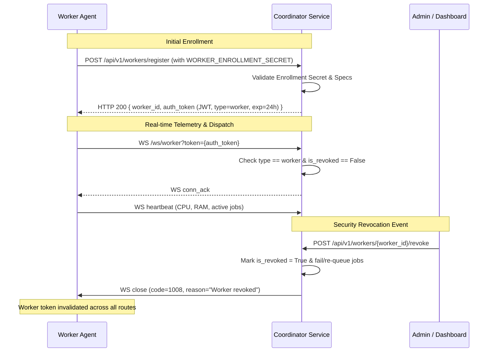

# WebSync AI — Remote Deployment & Network Security Guide

This document defines the operational security architecture and deployment requirements for running **WebSync AI** across untrusted, distributed networks connecting Windows, Linux, and macOS endpoints.

---

## 1. Network Topology & Communication Model

WebSync AI employs an **outbound-only worker topology**:

```
+--------------------------------------------------------------+
|                    Public Internet / WAN                     |
+--------------------------------------------------------------+
         ^                                           ^
         | (Outbound HTTPS / WSS)                    | (Outbound HTTPS / WSS)
         |                                           |
+-------------------+                       +-------------------+
|   Worker Node A   |                       |   Worker Node B   |
| (Private NAT/LAN) |                       | (Private NAT/LAN) |
|   No open ports   |                       |   No open ports   |
+-------------------+                       +-------------------+
         \                                           /
          \                                         /
           v                                       v
      +-------------------------------------------------+
      |        Reverse Proxy / Ingress Gateway          |
      |          (NGINX / Caddy / Cloudflare)           |
      |         - TLS 1.3 Termination (HTTPS/WSS)       |
      |         - Strict Rate Limiting                  |
      |         - DDoS Mitigation                       |
      +-------------------------------------------------+
                              | (Local loopback / VPC)
                              v
      +-------------------------------------------------+
      |        WebSync AI Coordinator (FastAPI)         |
      |         - JWT Authentication & RBAC             |
      |         - Adaptive Scheduler Engine             |
      |         - Worker Revocation & Health Telemetry  |
      +-------------------------------------------------+
                              |
                              v
      +-------------------------------------------------+
      |      Relational Database (PostgreSQL / SQLite)  |
      +-------------------------------------------------+
```

### Key Network Characteristics
1. **Zero Inbound Ports on Workers**: Worker machines reside safely behind home or corporate NATs and firewalls. They **never** open listening TCP ports to the public internet.
2. **Reverse Proxy TLS Termination**: The coordinator must be deployed behind an edge proxy (NGINX, Caddy, Traefik, or AWS ALB) terminating TLS 1.3. Plain HTTP and unencrypted WS are disabled in production.
3. **Outbound Keep-Alives**: Persistent WebSocket connections maintain stateful bi-directional communication, bypassing firewall idle drop timeouts with 20-second ping/pong heartbeats.

---

## 2. Transport Layer Security (TLS/WSS)

### Production Coordinator Configuration
In production environments (`ENVIRONMENT=production`):
- All endpoints must use `https://` and `wss://`.
- `validate_production_secrets()` automatically rejects:
  - Default development keys (`change-this-to-a-cryptographically-secure-key-in-production-min-32-chars` or `secret-key`).
  - Secret keys shorter than 32 characters.
  - Wildcard CORS origins (`*`).
  - Active `WORKER_DEV_AUTH_TOKEN`.
  - Missing `WORKER_ENROLLMENT_SECRET`.

### Worker TLS Verification
Workers validate TLS certificates by default using standard CA trust roots (`WORKER_VERIFY_TLS=true`).
- For self-signed certificates in private testing, explicit CA bundles should be mounted using the `SSL_CERT_FILE` environment variable.
- Disabling certificate verification (`WORKER_VERIFY_TLS=false`) is strictly prohibited in production.

---

## 3. Worker Enrollment & Identity Lifecycle



### Zero-Trust Token Separation
- **User Tokens**: Have claim `type: "user"` and short lifetime (60 minutes). Permitted to manage users, submit workloads, and access the dashboard. Cannot connect to `/ws/worker` or submit job results.
- **Worker Tokens**: Have claim `type: "worker"` and 24-hour lifetime. Permitted only to report heartbeats and execute assigned jobs. Cannot access dashboard feeds or administrative APIs.
- **Spoofing Prevention**: Worker routes verify `current_worker.worker_id == path_worker_id`. A compromised worker token cannot forge status updates or results for other worker nodes.

---

## 4. Resource Protection & Owner Autonomy

To protect computing nodes contributed by community members or cross-department teams:

1. **Owner Pause Sharing (`WORKER_PAUSE_SHARING=true`)**:
   - Node owners can immediately pause accepting any workloads without disconnecting from telemetry.
   - Dispatched jobs are cleanly rejected with code `Worker resource sharing paused by node owner` and re-routed.
2. **CPU Utilization Guard (`WORKER_MAX_CPU_PERCENT=90.0`)**:
   - If the host computer is engaged in local foreground tasks (e.g., gaming, video rendering, compiling), incoming workloads are automatically rejected.
3. **RAM Protection Guard (`WORKER_MIN_AVAILABLE_RAM_MB=512`)**:
   - Prevents Out-Of-Memory (OOM) operating system crashes by refusing jobs when available memory is below safety threshold.
4. **Input & Output Clamping**:
   - Maximum input payload: `2MB` (`MAX_JOB_INPUT_BYTES`).
   - Maximum output payload: `100KB` (`WORKER_MAX_OUTPUT_BYTES`). Excess output is truncated safely.

---

## 5. Workload Isolation & Platform Boundaries

> [!IMPORTANT]
> **Workload Isolation Boundary**:
> Current WebSync AI workers execute workloads using pure Python modular handlers (`matrix_multiply`, `data_processing`, `image_processing`) with strict input bounds checking.
>
> **These handlers run within the worker Python process and do NOT constitute a kernel-level container sandbox (such as Docker, Firecracker microVMs, or gVisor).**
>
> In untrusted public compute grids where users submit arbitrary executable code:
> 1. Run worker daemons inside unprivileged Linux containers (`--cap-drop=ALL`).
> 2. Implement an isolated container executor backend (Docker / Podman / Firecracker).
> 3. Enforce OS-level resource limits via Linux `cgroups v2` or Windows Job Objects.

---

## 6. Incident Response & Failure Recovery

### Coordinator Crash Recovery
When the coordinator process restarts:
1. `recover_jobs_on_coordinator_startup()` scans for stranded `SCHEDULED` and `RUNNING` jobs.
2. `SCHEDULED` jobs (unacknowledged) are reset to `QUEUED` and unassigned.
3. `RUNNING` jobs (interrupted mid-flight) are marked `FAILED` with explicit placement audit logs.
4. All workers are set to `disconnected` until their real-time WebSockets re-authenticate.

### Rate Limiting & Denial of Service
- In-memory sliding window rate limiters restrict authentication attempts:
  - `POST /auth/login`: 10 requests per minute per IP.
  - `POST /auth/register`: 20 requests per minute per IP.
  - `POST /workers/register`: 20 requests per minute per IP.
- Frame size caps on WebSockets (`MAX_WS_MESSAGE_SIZE_BYTES = 2MB`) prevent memory exhaustion from oversized messages.
