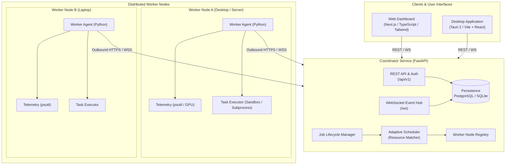

# WebSync AI — Architecture Specification

## 1. Executive Overview

**WebSync AI** is a cross-platform distributed computing platform that networks independent computing devices (nodes/workers) across local area networks and the internet to pool and schedule compute workloads. Connected nodes contribute available CPU, RAM, and supported GPU resources to execute scheduled workloads without requiring dedicated server infrastructure.

### Guiding Principles

1. **Real Execution Over Simulation**: The platform executes genuine computational tasks using actual system resources, real metrics from `psutil` / vendor GPU APIs, and authentic results.
2. **Zero Inbound Port-Forwarding**: Worker nodes initiate outbound TLS/HTTP/WebSocket connections to the central coordinator. Worker machines residing behind NAT or home routers do not require open inbound ports.
3. **Discrete Node Isolation**: Nodes operate strictly within their own hardware boundaries. WebSync AI does **not** assume unified virtual shared memory across machines. Workloads are scheduled to nodes whose individual capacity meets or exceeds job requirements.
4. **Lightweight & Modular**: Minimized overhead on host nodes; clear separation between coordinator orchestration, agent telemetry/execution, and user interfaces.

---

## 2. High-Level Architecture

---

## 3. Component Boundaries & Responsibilities

### 3.1. Coordinator (`services/coordinator`)
The central orchestrator responsible for cluster state and scheduling.
- **Worker Registry & Health Tracker**: Tracks active workers, heartbeat timeouts, hardware capabilities, and availability status (`idle`, `busy`, `offline`, `draining`).
- **Job Lifecycle Management**: Accepts job submissions, stores job payloads/specifications, tracks state transitions (`queued`, `dispatched`, `running`, `completed`, `failed`), and buffers logs/results.
- **Adaptive Scheduler**: Matches queued jobs against available worker nodes based on CPU cores, available RAM, GPU presence, and node reliability.
- **Real-Time Event Delivery**: Broadcasts state updates, live telemetry streams, and job progress to web dashboards and desktop shells via WebSockets.
- **Persistence Layer**: Interfaces with PostgreSQL (production) or SQLite (local development) via SQLAlchemy and Alembic.

### 3.2. Worker Agent (`worker/agent`)
A lightweight background service running on client hardware.
- **Outbound Communication**: Initiates all network traffic to the coordinator over HTTPS/WebSockets; maintains persistent heartbeats.
- **Telemetry Collection**: Real-time sampling of host CPU utilization, memory pressure, disk availability (via `psutil`), and optional GPU telemetry.
- **Capability Advertising**: Dispatches hardware specifications (CPU architecture, core count, total RAM, GPU device info, OS) upon registration.
- **Controlled Workload Execution**: Dispatches validated computing tasks inside isolated subprocesses or containerized runtimes with resource quotas.
- **Log Streaming & Result Reporting**: Captures stdout/stderr in real time and streams execution summaries back to the coordinator.

### 3.3. Web Dashboard (`apps/dashboard`)
A modern, responsive web application for managing the computing network.
- **Overview**: High-level status of the cluster, active nodes, queued tasks, and aggregate capacity.
- **Worker Management**: Detailed node list, hardware breakdowns, connection states, and node controls (drain/disable).
- **Job Center**: Job submission forms, queue inspection, status inspection, live execution logs, and downloadable artifacts.
- **Resource Monitor**: Time-series charts visualizing cluster-wide and per-node CPU/RAM/GPU metrics.
- **Activity Logs**: Auditable security and event streams.
- **Settings**: System configurations, coordinator URLs, and API key management.

### 3.4. Desktop Application (`apps/desktop`)
A cross-platform native wrapper using **Tauri 2** and Vite + React.
- Provides a tray icon and native window integration for monitoring local or remote WebSync AI clusters.
- Can bundle or manage the background worker agent daemon on end-user machines.

### 3.5. Shared Packages (`packages/`)
- `packages/shared-types`: Canonical TypeScript interfaces for API schemas, data models, and WebSocket event payloads.
- `packages/api-client`: Fully typed HTTP/WebSocket client used by both the dashboard and desktop apps.
- `packages/ui`: Shared design tokens, primitives, and reusable UI components.

---

## 4. Communication & Networking Architecture

### 4.1. NAT-Friendly Design
Traditional distributed systems often fail in home environments due to router firewalls. WebSync AI solves this:
1. **Outbound Handshake**: The worker connects to `https://coordinator/api/v1/workers/register`.
2. **Persistent Bi-directional Channel**: The worker opens a secure WebSocket connection `wss://coordinator/ws/worker/{worker_id}`.
3. **Heartbeat Protocol**: Workers ping the coordinator every 10 seconds with updated system metrics. If 3 consecutive heartbeats are missed (30s), the coordinator marks the node as `offline`.
4. **Task Dispatch**: Tasks are pushed from the coordinator to the worker through the established WebSocket channel or pulled by the worker via long-polling.

### 4.2. Memory Isolation Principles
- **No Shared Memory Pool**: WebSync AI does not attempt distributed shared virtual memory (DSM), which incurs unacceptable latency over non-specialized consumer networks.
- **Discrete Allocation**: Each job specifies minimum resource requirements (e.g. `min_ram_mb: 4096`, `min_cores: 4`). The scheduler assigns the job to a single node capable of executing it autonomously.

---

## 5. Technology Stack Summary

| Layer | Technology | Rationale |
| :--- | :--- | :--- |
| **Dashboard** | Next.js 15, TypeScript, Tailwind CSS, shadcn/ui, Recharts | Standard modern reactive web stack with rich visual components. |
| **Desktop Shell** | Tauri 2 + Vite + React | Native footprint, high performance, cross-platform portability. |
| **Backend API** | Python 3.13 / FastAPI, Uvicorn | Async I/O, auto-generated OpenAPI schemas, high performance. |
| **Validation** | Pydantic v2 | High-speed data parsing and validation in Python. |
| **Worker Agent** | Python, `psutil`, `httpx`, `asyncio` | Native system access, cross-platform OS metric retrieval. |
| **Persistence** | PostgreSQL (Async SQLAlchemy + Alembic) / SQLite | Robust relational persistence with local zero-config fallback. |
| **Monorepo** | pnpm workspaces + Python virtual environment / uv | Fast dependency management and code sharing across apps. |
