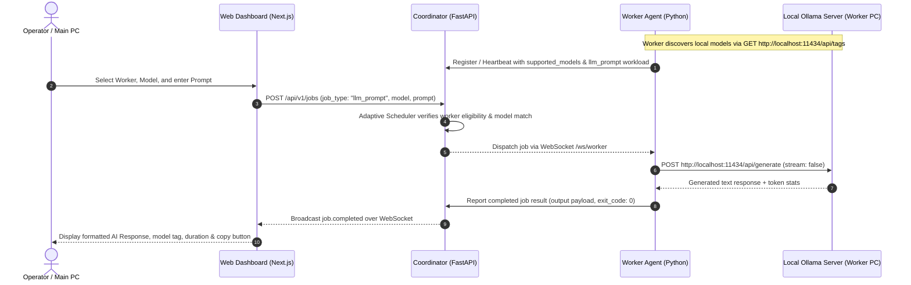

# Remote AI Prompt Execution with Ollama in WebSync AI

WebSync AI supports **Remote AI Prompt Execution (`llm_prompt`)**, allowing users to submit natural-language prompts from their main PC or web dashboard, execute them using local open-weight AI models running on remote connected worker computers, and receive formatted responses with token counts and latency metrics.

---

## 1. Architecture & Execution Workflow



---

## 2. Setting Up Ollama on a Worker PC

Worker nodes can optionally host local LLMs using [Ollama](https://ollama.com). If Ollama is not installed or not running, the worker agent continues running all other computational workloads (e.g., `matrix_multiply`, `data_processing`) without interruption.

### Step 1: Install Ollama

- **Windows**: Download the Windows installer from [ollama.com/download/windows](https://ollama.com/download/windows).
- **macOS**: Download from [ollama.com/download/mac](https://ollama.com/download/mac) or install via Homebrew: `brew install ollama`.
- **Linux**: Run the official installation script:
  ```bash
  curl -fsSL https://ollama.com/install.sh | sh
  ```

### Step 2: Download Models

Pull your preferred open-weight models locally:

```bash
# Lightweight and high-performance (3B parameters)
ollama pull llama3.2:latest

# Ultra-compact (1B parameters)
ollama pull llama3.2:1b

# Alternative high-performance models
ollama pull mistral:latest
ollama pull phi3:latest
ollama pull gemma2:latest
```

### Step 3: Run Ollama

Make sure Ollama is running locally:

```bash
ollama serve
```

> **Security Note:** Ollama listens only on `http://localhost:11434` on the worker machine. WebSync AI connects to Ollama strictly over localhost on the worker computer and never exposes Ollama to the public internet or external networks.

---

## 3. Worker Node Capability Discovery

When the WebSync AI Worker Agent starts up or dispatches periodic heartbeats:
1. It queries `http://localhost:11434/api/tags` to check if Ollama is running.
2. If available, it enumerates all installed local models (e.g. `llama3.2:latest`, `mistral:latest`).
3. It advertises `"llm_prompt"` in its `supported_workloads` list and passes `supported_models` in its registration and heartbeat frames.
4. If Ollama is stopped, the worker smoothly removes `"llm_prompt"` without crashing or dropping connection.

---

## 4. Submitting Remote AI Prompts from the Dashboard

1. Open the WebSync AI Dashboard (`http://localhost:3000`).
2. Navigate to **Jobs** and click **Submit Workload**.
3. Select **`llm_prompt (Remote AI Inference)`** from the **Workload Type** dropdown.
4. **Target Worker Node**:
   - Select **⚡ Auto-Assign (Adaptive scheduler)** to let the coordinator automatically route the prompt to the lowest-load online computer that has the requested model installed.
   - Or select a specific computer (e.g., your high-performance desktop).
5. **Inference Model**: Choose from the models installed on the chosen worker (or enter a custom model tag).
6. **Prompt**: Enter your prompt text (up to 32,768 characters).
7. (Optional) Enter a custom system prompt and adjust temperature.
8. Click **Send AI Prompt**.

---

## 5. Viewing Results & Metrics

When execution completes on the remote node:
- The dashboard automatically updates in real time via WebSockets.
- Open the job details modal to see:
  - **Prompt Submitted**: Exact prompt text sent to the remote worker.
  - **Generated AI Response**: Full text generated by the remote model with a **Copy Response** button.
  - **Model & Token Metrics**: Model tag, token generation count (`eval_count`), and total execution latency.
  - **Raw Output & Audit Trail**: Full structured JSON output and chronological cluster events.

---

## 6. Troubleshooting

| Issue | Cause | Solution |
| :--- | :--- | :--- |
| `Ollama inference engine is not reachable on this node` | Ollama is not installed or service is stopped on the worker PC. | Run `ollama serve` in a terminal on the worker machine. |
| `Model '<model>' not found in local Ollama repository` | The requested model is not downloaded on that specific worker node. | Run `ollama pull <model>` on the worker PC. |
| `Requested model '<model>' not available on worker` | The coordinator scheduler filtered out the worker because it hasn't advertised that model yet. | Pull the model on the worker PC and wait for the next heartbeat (10 seconds), or select a node that has the model installed. |
